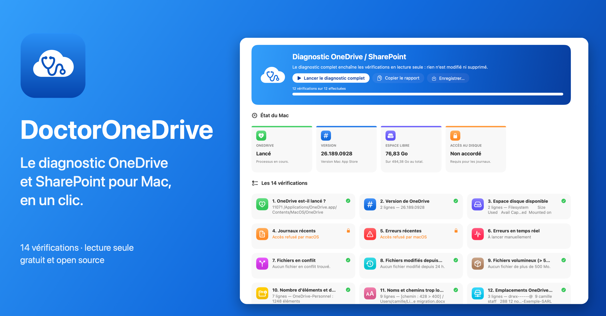
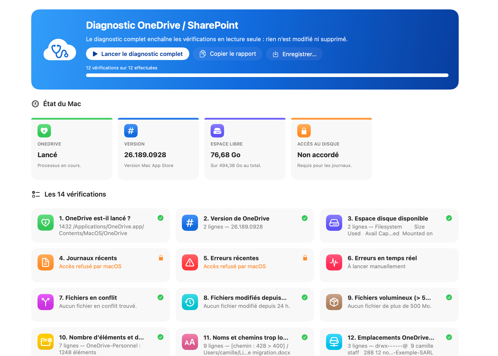
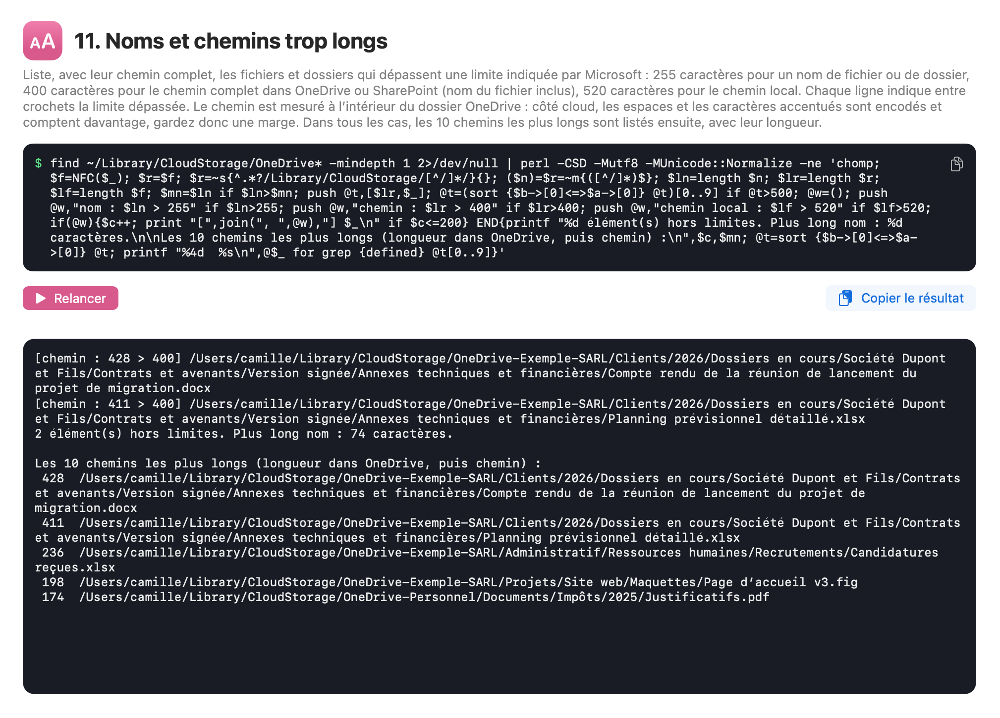
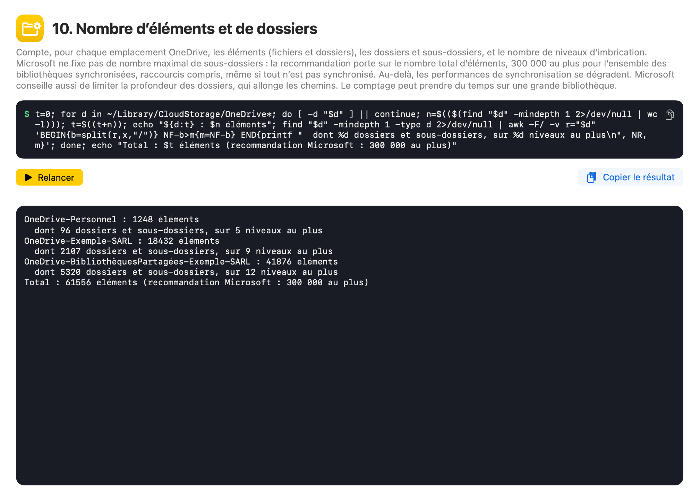
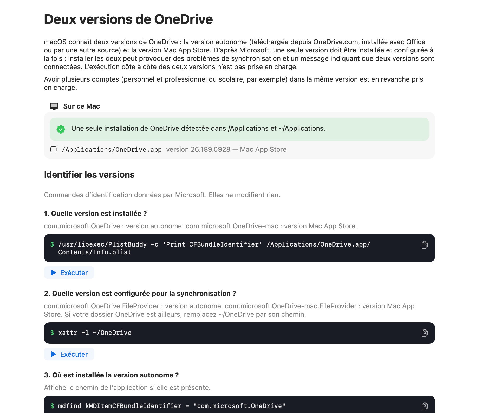
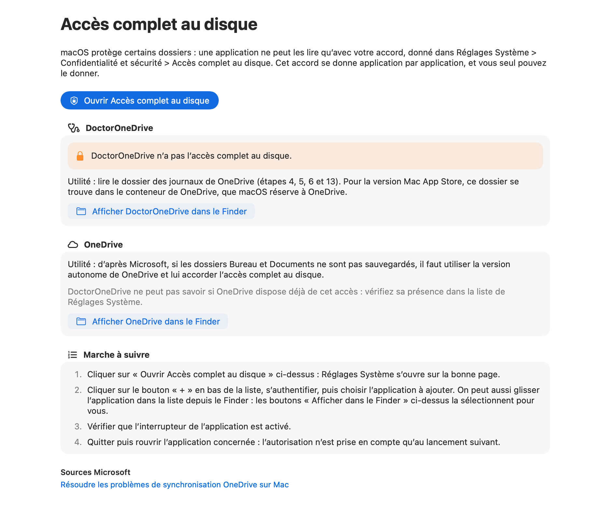

# SyncDoctor pour OneDrive et SharePoint



Diagnostic des synchronisations OneDrive et SharePoint sur Mac, en un clic.

SyncDoctor réunit dans une app macOS les commandes Terminal utiles pour comprendre pourquoi OneDrive ou une bibliothèque SharePoint ne synchronise plus. Chaque écran affiche la commande exacte qui est exécutée, et le résultat peut être copié ou enregistré dans un rapport à transmettre au support.

Tout le diagnostic est en lecture seule : l'app ne supprime rien et ne réinitialise rien.

## Téléchargement

[Télécharger SyncDoctor (.dmg)](https://github.com/mx-ch-rgb/SyncDoctor/releases/latest/download/SyncDoctor-1.2.2.dmg)

- macOS 27.2 ou ultérieur, Mac Apple Silicon.
- App signée et notarisée par Apple.
- Ouvrez le .dmg, puis glissez SyncDoctor dans Applications.

Le mode d'emploi est dans [A lire.md](A%20lire.md).

Au premier diagnostic, macOS demande l'autorisation d'accéder aux dossiers OneDrive ; au premier redémarrage de OneDrive, celle de le contrôler.

## Aperçu

| Vue d'ensemble | Noms et chemins trop longs |
|---|---|
|  |  |

| Nombre d'éléments | Deux versions de OneDrive | Accès complet au disque |
|---|---|---|
|  |  |  |

Les captures utilisent des données d'exemple.

## Les 14 vérifications

| N° | Vérification | Commande |
|---|---|---|
| 1 | OneDrive est-il lancé ? | `pgrep -fl "OneDrive"` |
| 2 | Version et identifiant de OneDrive | `defaults read /Applications/OneDrive.app/Contents/Info.plist CFBundleShortVersionString` puis `/usr/libexec/PlistBuddy -c 'Print CFBundleIdentifier' /Applications/OneDrive.app/Contents/Info.plist` |
| 3 | Espace disque disponible | `df -h /` |
| 4 | Journaux récents | `find <journaux> -type f -exec ls -lht {} + \| head -20` |
| 5 | Erreurs récentes | `grep -RniIE "error\|failed\|conflict\|blocked\|denied\|quota\|401\|403\|429\|500\|503" <journaux>/ \| tail -50` |
| 6 | Erreurs en temps réel | `tail -f <journaux>/*.log <journaux>/*/*.log \| grep -iE "error\|failed\|conflict\|denied\|blocked"` |
| 7 | Fichiers en conflit | `find ~/OneDrive ~/Library/CloudStorage/OneDrive* -type f \( -iname "*conflict*" -o -iname "*-copie*" -o -iname "*-copy*" \)` |
| 8 | Fichiers modifiés depuis 24 h | `find ~/OneDrive ~/Library/CloudStorage/OneDrive* -type f -mtime -1` |
| 9 | Fichiers de plus de 500 Mo | `find ~/OneDrive ~/Library/CloudStorage/OneDrive* -type f -size +500M -exec ls -lh {} \;` |
| 10 | Nombre d'éléments et de dossiers | comptage des éléments, des dossiers et des niveaux d'imbrication de chaque emplacement OneDrive (`find` et `awk`) |
| 11 | Noms et chemins trop longs | liste, avec leur chemin, des éléments dépassant 255 caractères pour le nom, 400 pour le chemin ou 520 pour le chemin local (`find` et `perl`) |
| 12 | Emplacements OneDrive et SharePoint | `ls -ld ~/Library/CloudStorage/OneDrive*` |
| 13 | Journaux SharePoint | `grep -RniIE "sharepoint\|(^\|[^a-z])spo([^a-z]\|$)\|sites\|document.?library" <journaux>/ \| tail -50` |
| 14 | Redémarrer OneDrive | `osascript -e 'quit app "OneDrive"'; sleep 5 && open -a OneDrive` |

Les commandes complètes des étapes 10 et 11 s'affichent dans l'app. Les limites utilisées sont celles de Microsoft : 300 000 éléments au plus pour l'ensemble des bibliothèques synchronisées (Microsoft ne fixe pas de nombre maximal de sous-dossiers), 255 caractères par nom, 400 caractères pour le chemin complet et 520 pour le chemin local.

Les journaux sont rangés dans des sous-dossiers, un par compte. Seuls les fichiers `.log` (`OneDrive-*.log`, `SyncDiagnostics.log`) sont du texte lisible ; les fichiers `SyncEngine-*.odl` et `.aodl` sont binaires, d'où l'option `-I` des recherches.

`<journaux>` dépend de la version de OneDrive installée, que l'app détecte :

- version autonome : `~/Library/Logs/OneDrive` ;
- version Mac App Store : `~/Library/Containers/com.microsoft.OneDrive-mac/Data/Library/Logs`. Ce dossier appartient à OneDrive : pour le lire, SyncDoctor doit être ajouté dans Réglages Système > Confidentialité et sécurité > Accès complet au disque. Sans cet accord, l'app l'indique au lieu de conclure à l'absence d'erreur.

Le « diagnostic complet » enchaîne les étapes 1 à 5 et 7 à 13. Le suivi en temps réel (6) et le redémarrage (14) se lancent à la main ; le redémarrage demande une confirmation.

## Aide intégrée

- **Conseils** : à faire, à ne pas faire, que faire si le problème persiste, et les recommandations de Microsoft (raccourcis OneDrive plutôt que le bouton Synchroniser, limites de taille et de nommage).
- **Accès complet au disque** : lien direct vers le réglage macOS, état de l'autorisation pour SyncDoctor et marche à suivre pour SyncDoctor et OneDrive.
- **Deux versions de OneDrive** : détection des installations présentes, commandes d'identification et procédure de correction de Microsoft, puis un nettoyage manuel dans le Terminal, signalé comme non documenté par Microsoft.
- **Reset OneDrive** : la procédure de réinitialisation de Microsoft, en dernier recours. L'app ne la lance pas elle-même.

Chaque écran d'aide cite les pages Microsoft dont il reprend le contenu :

- [Pourquoi ai-je deux versions de OneDrive sur mon Mac ?](https://support.microsoft.com/fr-fr/onedrive/why-do-i-have-two-versions-of-onedrive-on-my-mac)
- [Résoudre les problèmes de synchronisation OneDrive sur Mac](https://support.microsoft.com/fr-fr/onedrive/fix-onedrive-sync-problems-on-mac)
- [Réinitialiser OneDrive](https://support.microsoft.com/fr-fr/onedrive/reset-onedrive)
- [Synchroniser des fichiers SharePoint et Teams avec votre ordinateur](https://support.microsoft.com/fr-fr/sharepoint/sync/sync-sharepoint-and-teams-files-with-your-computer)
- [Quelles sont les limites de longueur des chemins d'accès aux fichiers ?](https://support.microsoft.com/fr-fr/onedrive/what-are-file-path-length-limits)
- [Restrictions et limitations dans OneDrive et SharePoint](https://support.microsoft.com/fr-fr/office/restrictions-and-limitations-in-onedrive-and-sharepoint-64883a5d-228e-48f5-b3d2-eb39e07630fa)

## Compiler depuis les sources

Xcode 27 ou ultérieur est requis.

```bash
./build.sh
```

Le script compile l'app pour arm64, l'assemble dans `build/SyncDoctor.app` et la signe avec le certificat « Developer ID Application » du trousseau. Sans certificat, utilisez une signature locale :

```bash
SIGN_ID=- ./build.sh
```

`./make_dmg.sh` crée le .dmg et `./notarize.sh` le fait notariser par Apple (un profil `notarytool` est nécessaire, voir l'en-tête du script).

Les images de ce dépôt se régénèrent avec le mode capture de l'app (variables `SD_*`, voir `App.swift`) et `scripts/make_visuals.swift`.

## Licence

Logiciel libre sous [licence MIT](LICENSE). Conçu et développé par Marc Christiaens.

SyncDoctor est une application indépendante, sans lien avec Microsoft. OneDrive et SharePoint sont des marques de Microsoft Corporation.
